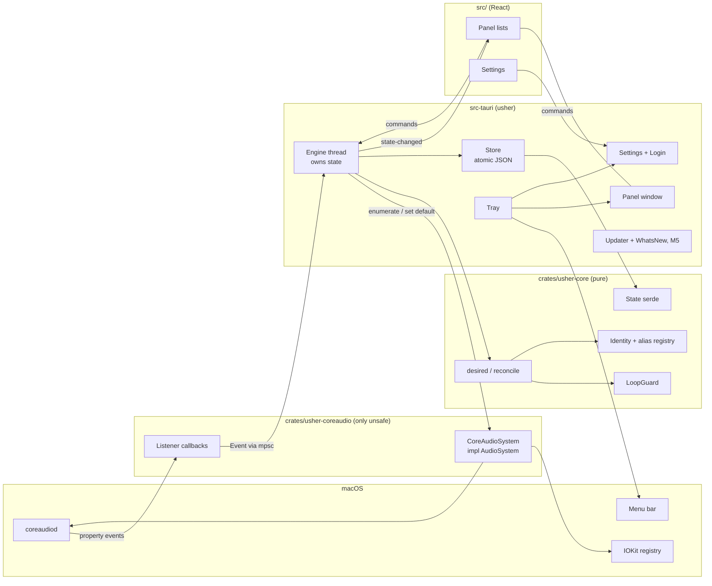
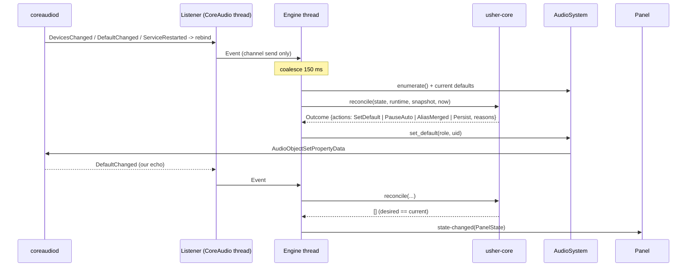
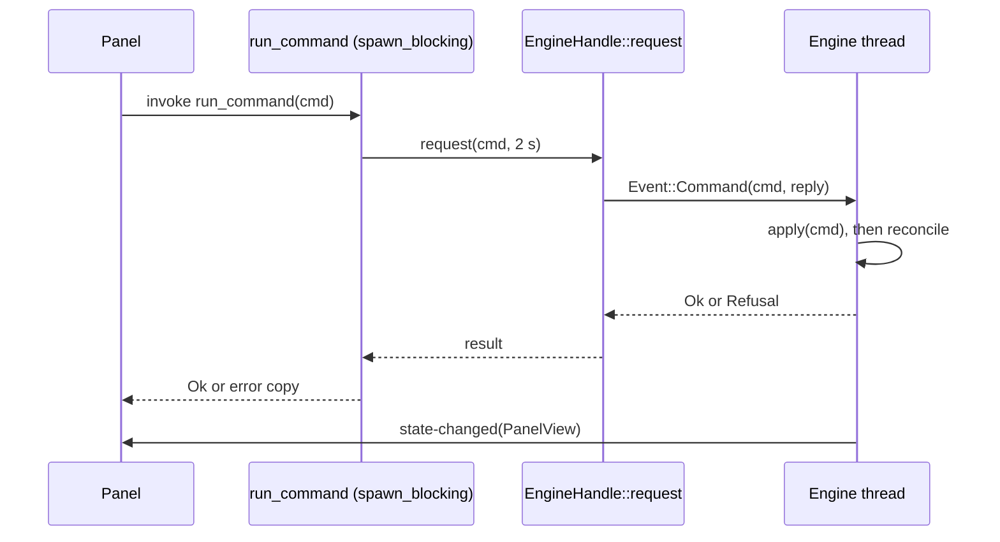
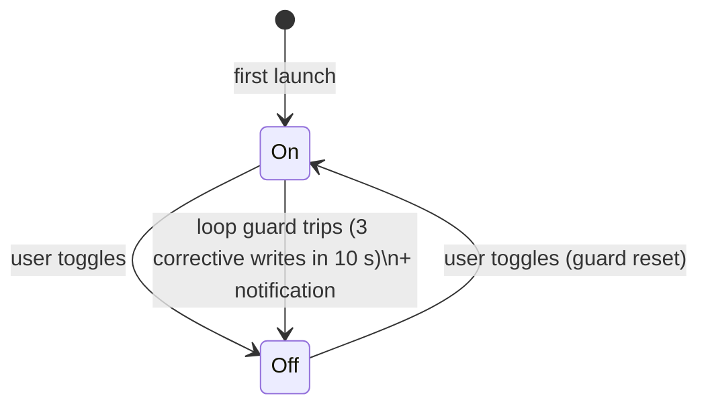
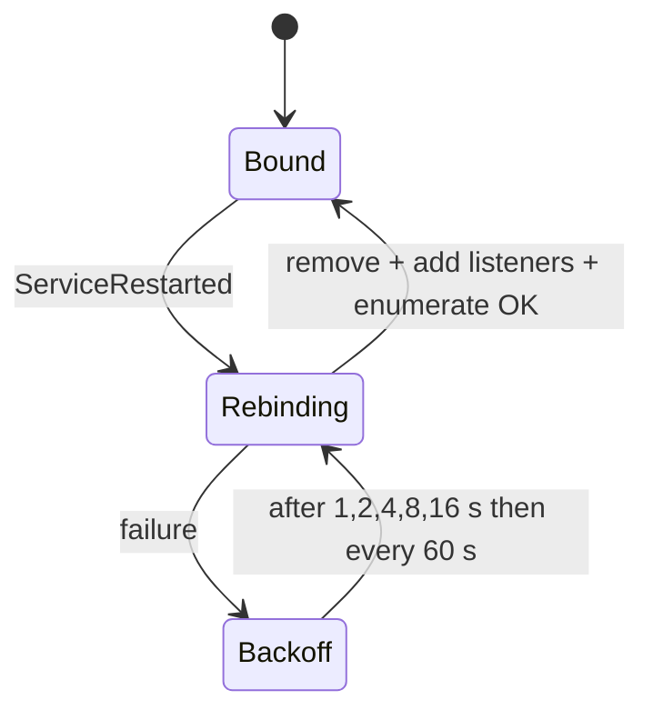

# usher architecture overview

The design rationale is in `docs/superpowers/specs/2026-11-23-usher-design.md`. The decisions are in `docs/adr/`.

## Components

## Event to switch

Timers on the engine thread:

- coalesce 150 ms;
- save 500 ms;
- USB recheck 500 ms;
- rebind backoff 1/2/4/8/16/60 s.

## Panel command

## Auto-switch state

## coreaudiod restart

## Unit boundaries

| Rule | Enforced by |
|---|---|
| `unsafe` only in `usher-coreaudio` | `#![forbid(unsafe_code)]` in the other crates |
| `usher-core` has no I/O, no clock, no tauri/objc2 | Cargo deps; time is passed in |
| Files ≤ 300 lines, functions ≤ 40 lines (non-test) | `scripts/check-size.mjs`, `clippy::too_many_lines` |
| Mutable state has one owner (engine thread) | Design; UI sends commands only |
