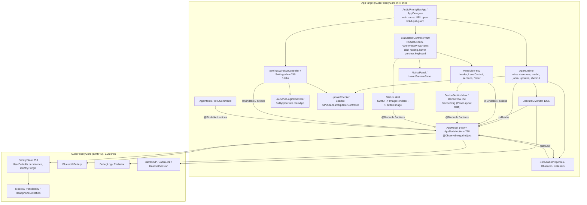

# Audit: app shell, UI, UX and release of the Swift implementations

Scope: the shell side (panel, menu-bar item, windows, settings, login item, structure, release) of two read-only sources. Audio engine, store and identity are covered elsewhere.

- **fork**: camguillory/Audio-Priority-Bar v2.13.1 (146 commits; rebuilt from scratch at 2.0.0, commit `e93a875`). Paths below are relative to the fork root; `AudioPriorityBar/` is the app target, `AudioPriorityCore/` the Swift package.
- **upstream**: tobi/AudioPriorityBar (23 files, 2.3k Swift lines, archived: issue #43 says "unmaintained, new home").

Citations are `file:line` in the fork unless prefixed `upstream`. Nothing was built or run; behaviour claims come from code and issue text. Statements marked *(inferred)* are not backed by a line of code or an issue.

## 1. Panel UX

### 1.1 Structure, top to bottom

`PanelView.body` (`PanelView.swift:55-248`) stacks, in a fixed 380 pt wide column (`DeviceDrag.swift:52`):

1. **Automatic switching header** (`PanelView.swift:57-102`). Title, optional profile menu (only when more than one profile, `:63`), and a switch toggle. `isManualMode` is the inverse of the toggle (`:69-70`). Below it, one caption line, mutually exclusive:
   - "takeover" warning, when macOS or another app keeps stealing the default (`:78-95`), with a "Fix in Settings..." link for Bluetooth devices;
   - otherwise an `automationNote` (`:296-318`): "No output selected", "Your choice stays until you turn this on" (manual), "Your choice stays until a device your list would pick connects" (kept pick), or "Skipping X: headset off / never auto-selected".
2. **Level controls** (`:106-137`, `LevelControl` `:349-465`). Output row always; microphone row only when an input is current (`:121`). Each row: round mute button (icon shows device hardware glyph, previews the toggled state on hover, turns solid red when muted), slider, `NN%` text. If the device has no settable volume the slider is replaced by a note, "This device does not allow volume control" (`:400-407`). Scroll wheel over the row adjusts level by 2 % per tick (`:412-415`).
3. **Three device lists** in a `ScrollView` (`:144-207`): Speakers, Headphones, Microphones (`DeviceSectionView`, `DeviceListView.swift:41-243`). Output lists are separate because the user, not the system, chooses the category (`DeviceIcon.swift:7-8`).
4. **Footer** (`:467-543`): checkbox "Show hidden and disconnected devices" and a "Audio Priority Bar Settings..." row.

### 1.2 ASCII sketch (fork, default state, three lists populated)

```
+--------------------------------------------------+  380 pt wide, 12 pt radius
| Automatic switching          [Desk v]    (o====) |  profile menu only if >1 profile
|  Skipping HDMI Out: never auto-selected          |  caption: takeover / automation note
|                                                  |
|  (spk)  ---------o-----------------------  62%   |  Output level, mute button at left
|  (mic)  --------------o-------------------  71%   |  Microphone level (only if input current)
|--------------------------------------------------|
| Speakers                                         |
|  1  (hifi) Desk Speakers      [Connected]  ...   |  ... = actions menu (hover only)
|  2  (disp) LG HDR 4K          [Hidden]           |
|--------------------------------------------------|
| Headphones                                       |
|  1  (AirPods) AirPods Pro   (filled badge=active)|  accent-filled icon badge = current
|        battery L 80%  R 78%  Case 40%      ...    |  status labels after name
|  2  (hp) Jabra Evolve2   [mic muted] 54%  NC SID |  headset buttons always visible
|  3  (hp) Sony WH-1000XM5  wifi.slash Last seen 2d|  dimmed row = disconnected
|                                          [Connect]|  hover pill for paired-off Bluetooth
|--------------------------------------------------|
| Microphones                  [With headphones v] |  menu only if "mics follow output"
|  1  (mic) MacBook Air Microphone                 |
|  2  (mic) Jabra Evolve2 Mic        [Mic only]    |  hover override pill
|  (empty list shows: "No microphones shown")      |
|--------------------------------------------------|
| [ ] Show hidden and disconnected devices         |
|--------------------------------------------------|
|  (gear)  Audio Priority Bar Settings...          |
+--------------------------------------------------+
```

Row anatomy (`DeviceRowView.swift:180-301`), left to right: a 14 pt slot showing the priority number, replaced by a three-line drag handle on hover or drag (`:183-198`); a 26 pt circular transport/hardware icon (accent-filled with white glyph when current, orange when current but unavailable, `:200-209, :366-368`); the name (one line, struck through when "never auto-select", grey when disconnected/unavailable/never, `:210-215, :400-402`); status labels; overlaid trailing controls shown only on hover, VoiceOver or keyboard focus (`:396-398`, `:442-460`).

Row metrics: 30 pt row, 3 pt gap, 18 pt section header, 16 pt gap between sections (`DeviceListView.swift:34-39`, `DeviceDrag.swift:56`). List height is capped at `min(500, max(240, screenHeight/2))`, scrolls beyond that, and shows the scroll indicator only when capped (`PanelView.swift:43-53, :144-148`).

### 1.3 What a row shows

| Datum | Where | Citation |
|---|---|---|
| Name | row text | `DeviceRowView.swift:210` |
| Hardware/transport icon | circular badge; by name keyword first (AirPods, iPhone, camera, display), then user category (headphones), then transport (AirPlay, virtual, built-in, Bluetooth), then role | `DeviceIcon.swift:9-50` |
| Connected | no label for a normal wired device; Bluetooth connected-not-in-use shows "Connected" (and a hover Disconnect pill) | `DeviceRowView.swift:114-116, :472-474` |
| Disconnected / last seen | `wifi.slash` + "Last seen 3 days ago" from `StoredDevice.relativeLastSeen()`, or "Disconnected" if no record; row name goes grey | `DeviceRowView.swift:102-113`, `Models.swift:166` |
| Connecting | "Connecting..." status | `DeviceRowView.swift:100-101` |
| Volume | not per row; only for the current device in the top level controls | `PanelView.swift:106-137` |
| Mute | red `speaker.slash`/`mic.slash` status | `DeviceRowView.swift:142-148` |
| Hidden ("ignore") | "Hidden" status with `eye.slash`; only visible with Show hidden on | `:139-141` |
| Never auto-select ("never use") | name strikethrough, grey, tooltip "Never auto-select" | `:212-213, :400-402` |
| Link/battery state | Jabra "Headset off", "Link unknown"; AirPods/Jabra battery badges | `:122-138, :169-178` |
| Current | filled accent badge; "Current" in orange if its link is down | `:93-99, :203-208` |

Statuses collapse to one tooltip joined by " . " (`:235`). They are hidden from VoiceOver as separate elements; the row exposes one accessibility value "Priority N of M, Active, ..." (`:289-294, :146-153` in the second chunk, `accessibilityValue`).

### 1.4 Modes: there is no edit mode in the fork

- Fork: reordering is always live. Drag any row, or use Move Up / Move Down in the row menu (`DeviceRowView.swift:~723-735` actions block, `:295-300` accessibility actions). README states "Speakers, Headphones, and Microphones remain visible in both modes" (README.md:~137), where "both modes" means automatic/manual, not edit/normal.
- Upstream had a global Edit/Done button in the footer (`upstream Views/MenuBarView.swift:103-118`) that switched row behaviour and hid the "show hidden" toggle (`:93`). Upstream issue #15 ("Edit vs Done - Not clear the actual status of the mode") shows users could not tell whether the label named the current state or the action; the fork owner replied that the mode was removed outright.
- The only remaining mode in the panel is the automatic/manual toggle plus the "Show hidden and disconnected devices" filter.

### 1.5 Drag-reorder mechanics

Hand-built, not `.onDrag`/`.onMove`. All geometry is computed from fixed metrics, never measured, to avoid a layout feedback loop (`DeviceDrag.swift:46-49`).

- Gesture: `DragGesture(minimumDistance: 8)` per row in a named coordinate space (`DeviceListView.swift:191-223`). `DeviceDrag` state is held at panel level so a row can cross lists (`PanelView.swift:18-19`).
- Targeting: `PanelLayout.target(at:)` maps a point to `(section, insertionIndex)`, rounding to the nearest gap (`DeviceDrag.swift:66-70, :218-234`).
- Preview: other rows slide by one pitch to open the destination gap and close the source gap (`rowOffset` `:150-164`); sections below shift by `grow/shrink` (`:108-133`); the lifted row snaps into the target gap (`liftedOffset` `:166-183`) with 1.02 scale, border and tint (`DeviceRowView.swift:246-251`). Spring animation, disabled under Reduce Motion (`DeviceListView.swift:166-177`).
- Rules: input rows cannot enter output lists and vice versa; the row shows a red "nosign" badge and the drop is cancelled (`DeviceDrag.swift:34-43`, `DeviceListView.swift:134-145`). Speakers and Headphones accept each other's outputs (drop changes category via `model.dropDevice(... into: category ...)`, `DeviceListView.swift:212-216`).
- Empty list keeps one placeholder row of height so first/last drop changes no height (`DeviceDrag.swift:77-85`, `DeviceListView.swift:99-112`).
- Panel height only grows during a drag so the panel never resizes under the cursor (`PanelView.swift:40-46`).
- Drag is cancelled when the panel loses key status (`PanelView.swift:230-241`) or the dragged device vanishes (`:213-216`).
- Persistence: `moveOutput`/`moveInput` write the shown order to the store immediately, then re-apply the highest priority if automatic (`AppModelActions.swift:~590-640`).
- Upstream's version had a dead zone/off-by-one that needed ~1.5 rows of travel (PR #35 body); the fork's insertion-gap rounding avoids it.

Cost: about 235 lines of layout math in `DeviceDrag.swift` plus hover bookkeeping across `PanelView`, `DeviceSectionView` and `DeviceRow` (`hoveredDeviceID`, `highlightedPairedDeviceID`, `onContinuousHover` with `containsRow` hit-testing, `PanelView.swift:19-26, DeviceRowView.swift:252-274`). Hover had to be hand-rolled because rows move under a stationary pointer while dragging.

### 1.6 Row actions menu and context menu

`actionItems` (`DeviceRowView.swift:~690-795` in the second chunk; the Menu is at `:~676`): Use as Microphone / Use for Sound Output; selection override ("Use Output Only", "Use for Input and Output"); toggle "Use Its Microphone Too"; Connect (paired-off Bluetooth); Move Up / Move Down; Move to Headphones / Speakers (outputs only); Hide Device / Unhide Device; Never Auto-Select / Allow Auto-Selection; Disconnect; and, **only when the device is disconnected**, Forget Device (destructive, confirmation sheet `:332-347`: "Its saved priority, category, and visibility will be removed."). The same items are on right-click (`:277`).

### 1.7 Empty states and disconnected-but-remembered devices

- Empty lists: italic tertiary "No speakers shown", "No headphones shown", "No microphones shown", also the drop target (`PanelView.swift:154, :168, :182`; `DeviceListView.swift:99-112`).
- No output: header note "No output selected" (`PanelView.swift:299-301`).
- Remembered but absent devices are listed **only** when "Show hidden and disconnected devices" is on: `refreshDevices()` appends `store.knownDevices` not currently connected as `disconnectedDevice()` rows (`AppModel.swift:686-699`). They appear dimmed with "Last seen ...".
- Exception: paired Bluetooth audio devices that are currently off are always listed at their rank, dimmed, with a Connect pill, unless forgotten (`AppModel.swift:677-685`; README "Paired Bluetooth speakers and headphones stay listed at their rank while they are off").
- Hidden devices likewise appear only under the same toggle; the active device always stays listed even if hidden (README). `showAll` is not persisted (`AppModel.swift:115`, plain `var showAll = false`).
- Consequence for v1: the priority list the user sees in normal view is the *connected* subset (plus paired-off Bluetooth), so a priority rank number shown on a row can skip values. The remembered ordering is visible only after enabling the checkbox.

### 1.8 Keyboard handling inside the panel

`PanelWindow.keyDown` maps Up/Down/Left/Right/Return/Space to `ListKey` (`StatusItemController.swift:64-103`). `AppModel.panelItems` defines the walk order (`AppModel.swift:88-98`). Up/Down highlight; Return/Space acts; Left/Right adjust a level, profile or mic order, or Right opens a device's actions menu (`:261-305`). Pointer movement clears the keyboard highlight (`:256-258`). Highlight is announced to VoiceOver via `.announcementRequested` (`:307-340`). Escape closes (`cancelOperation`, `:75-77`). Opening the row menu from the keyboard synthesises a right-mouse-down event because SwiftUI cannot open a context menu programmatically (`DeviceRowView.swift:303-327`).

## 2. Menu-bar icon

Rendered by the SwiftUI `StatusLabel` (`StatusItemController.swift:760-919`) through `ImageRenderer` into the `NSStatusItem` button image (`:131, :386-412`). Not a MenuBarExtra label.

| Visual state | Driver | Citation |
|---|---|---|
| Output glyph: hardware icon (AirPods, headphones, display...) or generic speaker with `variableValue` = volume | current output device and category; generic speaker shows volume waves | `:805-815, :891-896` |
| Filled variants | `.fill` symbol when one exists | `:912-918` |
| `speaker.slash.fill` | active output muted | `:803-804` |
| `mic.slash.fill` beside glyph, red, pulsing (0.45 / 1 opacity) | active input muted; pulse = `micFlashState`, disabled under Reduce Motion; Settings toggle "Pulse muted microphone" | `:795-797, :880-886` |
| Input glyph and optional "in:/out:" labels | Settings: Output only / Output and microphone / labeled; unlabeled mode drops the mic glyph when it is the output's own half | `:769-798, :863-878` |
| `wave.3.right` volume wave | Settings "Volume level", only beside hardware glyphs with controllable volume | `:818-831` |
| `exclamationmark.triangle.fill` | active output's Jabra headset link is down | `:837-840` |
| Rounded outline | Settings "Outline" | `:847-854` |
| **Solid red background, white glyphs** | **automatic switching off** (`isManualMode`) and Settings "Red while automatic switching is off" (`showsRedIconBackground = redIconWhenManual && isManualMode`) | `AppModel.swift:154`, `StatusItemController.swift:395-399, :416` |
| Highlighted while panel is open | `button.highlight(true)` | `:510` |

Notes:

- Automatic-off is *not* shown by default. Without the red-background setting, manual mode is visible only inside the panel (toggle) and in the accessibility value ("Manual, speakers, ...", `:734-746`). For v1, the requirement "icon state for auto-switch off" is satisfied by the opt-in red state only; the fork's older design used a `hand.raised.fill` glyph in custom mode (`upstream AudioPriorityBarApp.swift:~29-35`).
- Template vs colored: the plain image is a template (system dims it on inactive displays). Once red or a red mic is drawn, it becomes a non-template drawn image and loses inactive-display dimming; the code says so (`:423-424`). Fixed width reserved for the widest glyph so the item never resizes (`:777-781, :405`).
- Click routing: left = toggle panel; right or ctrl-left = context menu (Mute Microphone, Check for Updates, Settings, Quit); option-left = toggle microphone mute (`:7-33, :454-474, :342-365`).
- Hover preview: after 300 ms a click-through window shows the devices behind the glyphs (`:600-619`; `HoverPreviewPanel` `NoticePanel.swift:251-295`). Implemented with global/local `mouseMoved` monitors because a tracking area is "never delivered to the status item button" on macOS 27 (`:586-598`). It uses Accessibility to avoid triggering over a icon hidden behind the hidden-items arrow (`:621-648`).

## 3. Panel window mechanics

### 3.1 Construction

- `NSApplication` accessory policy, no SwiftUI `App` scene: manual `AppDelegate`, `app.setActivationPolicy(.accessory)` (`AudioPriorityBarApp.swift:5-16`), `LSUIElement` true (`Info.plist:23-24`). A hand-built main menu supplies Cmd-, / Cmd-Q / Edit items so text fields work (`AudioPriorityBarApp.swift:99-143`).
- `NSStatusItem` with variable length; button action on `.leftMouseUp` and `.rightMouseUp` (`StatusItemController.swift:165, :200-205`).
- `PanelWindow: NSPanel` with `.nonactivatingPanel`, `canBecomeKey` true, level `.popUpMenu`, non-movable, transparent, shadowed, `collectionBehavior = [.canJoinAllSpaces, .fullScreenAuxiliary]` (`:64-103, :245-251`). Content is an `NSHostingController` whose `sizingOptions = []` so AppKit does not resize the panel around its bottom edge (`:232-236`).
- Background: `glassEffect(.regular)` on macOS 26+, else `NSVisualEffectView(.menu)` with a stretchable mask image and `state = .active` (an inactive nonactivating panel would otherwise render inactive material) (`PanelView.swift:592-652`). The hosting view layer is also corner-masked because Liquid Glass leaves the window rectangular and the shadow draws a square (`StatusItemController.swift:237-242`).

### 3.2 Sizing and positioning

- SwiftUI reports its size through `onGeometryChange`; `fitPanel` applies it with `setFrame` in one step, keeping the top under the item (`PanelView.swift:244`, `StatusItemController.swift:557-563`). The panel grows/shrinks only at the bottom.
- `PanelPlacement.origin` centers under the status item, clamps 4 pt inside `screen.visibleFrame`, 4 pt below the button (`:46-62`).
- The anchor X is frozen at open (`panelAnchorX`, `:134-137, :498-500`) because the status item changes width with its glyphs; re-centering would slide the open panel.
- Multiple displays: the screen is `button.window.screen`, i.e. the display whose menu bar holds the item (`:576`). Settings opens on the same screen (`:528-532`, `SettingsView.swift:722-736`). The list-height cap picks the screen under the mouse (`PanelView.swift:48-53`), a slight inconsistency with the placement screen. Whether macOS shows one status item per display depends on "Displays have separate Spaces" *(inferred; code only handles the one `button.window`)*.

### 3.3 Dismissal

- Outside click: `windowDidResignKey` hides the panel, checking `attachedSheet == nil`, no modal window, and `!isRelatedToPanel(NSApp.keyWindow)`, on the next runloop turn (`:704-724`). It is a nonactivating panel, so app activation cannot be used; key status is the signal.
- Click on the status item while open: handled as toggle; if the click that caused resign-key landed on the status item, `suppressNextClickAt` swallows the next open for 2 s so the same click does not close then immediately reopen (`:539-543, :481-495, :9-33`).
- Escape closes. Opening Settings or the context menu hides the panel first (`:220-228, :514-516`).
- Forget confirmation is an AppKit sheet attached to the panel because a SwiftUI dialog steals key status and would dismiss the panel (`DeviceRowView.swift:329-347`).
- Timer: battery refresh every 60 s while open; stopped on close (`StatusItemController.swift:504-506, :550-551`).

### 3.4 Why MenuBarExtra was abandoned

The fork contains no written rationale (`grep -ri menubarextra` over fork sources finds nothing; the 2.0.0 commit message says only "Rebuild the macOS menu bar app"). The evidence is the upstream issues the fork's author inherited, plus the fork's own comments:

- Upstream used `MenuBarExtra { ... }.menuBarExtraStyle(.window)` (`upstream AudioPriorityBarApp.swift:9-17`).
- On macOS 26, a `ScrollView` inside the `.window` MenuBarExtra reports zero ideal height, so the list collapsed, leaving header and footer (upstream PRs #22, #23, #28, #30, #33, #35, #37; all describe a blank or collapsed device list; #35: "On macOS 26 a ScrollView reports a 0 ideal height"). Workarounds proposed in those PRs: remove the ScrollView (loses scrolling; upstream issue #16 "Does not scroll"), add `fixedSize`, measure content via `PreferenceKey`, or compute a height from the screen. Four of these PRs (#22, #28, #30, #33) are still open and three (#23, #35, #37) were closed, none merged in the upstream repo, which was later declared unmaintained (issue #43).
- The fork keeps a scroll view but owns window sizing: it measures SwiftUI content itself and sets the panel frame explicitly (`StatusItemController.swift:232-236, :557-563`; `PanelView.swift:43-53, :244`).
- Other things `MenuBarExtra` cannot do that the fork needs: option/right-click on the item (`:7-33`), a per-glyph rendered, widths-reserved, red-backed label (`:386-412`), hover preview over the item (`:586-648`), key handling for list navigation (`:64-103`), a non-activating panel with sheets attached, and deterministic dismissal.
- Why not `NSPopover`: not documented anywhere in the sources. The `.nonactivatingPanel` choice means the frontmost app stays frontmost while the panel is used, which matters for a tool used mid-call *(inferred)*.

The price is an in-house window layer of ~900 lines (`StatusItemController.swift`) plus ~400 (`NoticePanel.swift`), with many macOS-version-specific workarounds (comments cite macOS 26 glass and a macOS 27 status-item tracking regression).

## 4. Settings window (v1-relevant parts)

Window: `NSWindow` titled/closable with an `NSTabViewController` in toolbar style, five panes: Menu Bar, Devices, Profiles, Shortcuts, App (`SettingsView.swift:9-27, :686-720`). Opens on the screen of the status item and only re-centres if it is on a different screen (`:722-736`, `SettingsPlacement` `:~650`). Activation uses `NSApp.activate(ignoringOtherApps: true)`.

| Pane | Controls | v1 relevance |
|---|---|---|
| Menu Bar | live icon preview in a fake menu bar strip (`:159-180`); Shows (Output only / Output and mic / labeled); Outline; Volume level; Pulse muted mic; **Red while automatic switching is off**; notices (switch notice, muted-recording reminder); Hover preview | Keep: red-when-off (v1 requirement). Drop the rest from v1 (mic-mute reminder, pulse, hover preview, labeled modes). |
| Devices | Select headset input and output together; Microphones follow the output; Hide new HDMI/DisplayPort outputs; Mute speakers when headphones disconnect; Jabra busylight | Only "hide new display outputs" is plausibly v1 (it governs which new devices enter the list). The rest are beyond v1 scope. |
| Profiles | list/rename/delete profiles; Focus filter hint | Out of v1. |
| Shortcuts | global mic-mute shortcut (KeyboardShortcuts), URL commands, Shortcuts actions | Out of v1. |
| App | **Open at Login** toggle with approval prompt and error line (`:257-282`); **Updates**: "Install updates automatically" + Check for Updates, disabled with "Updates are off in development builds" (`:284-305`); Troubleshooting: debug log, recent switches, copy diagnostics, redacted log export (`:307-406`); version line (`:409-415`) | Keep: Open at Login, update toggle/check, version. Troubleshooting: a small "copy diagnostics" is worth keeping. |

There is no per-device forget list in Settings; forgetting is only from a disconnected row's menu (Section 1.6). A v1 store-management view would be new.

## 5. Launch at login

Fork: `LaunchAtLoginController` (`LaunchAtLoginController.swift:1-72`) wraps `SMAppService.mainApp`:

- State read from `SMAppService.mainApp.status`; `isEnabled = .enabled || .requiresApproval` (`:40`), `requiresApproval` separate (`:41`).
- `setEnabled` calls `register()`/`unregister()`; on failure it re-reads status, stores `error.localizedDescription` and logs (`:45-61`).
- Closures for status/register/unregister are injected for tests (`:12-32`).
- UI: toggle plus an "Approval needed in Login Items" row with a button calling `SMAppService.openSystemSettingsLoginItems()` (`SettingsView.swift:257-272`). Status is refreshed on appear and on `didBecomeActive` because approval happens in System Settings while the window stays open (`:277-282`).
- Status transitions are logged ("off", "on", "waiting for approval in Login Items", "not found") (`:63-71`).

Upstream's version: `didSet`-driven `@Published isEnabled` that registers on every set, `print` on failure, and a hack to refresh without re-triggering `didSet` (`upstream Services/LaunchAtLoginManager.swift:8-16, :51-59`). Treats `.requiresApproval` as off, so the toggle shows off while a pending approval exists.

Pitfalls observed or implied:

1. **`.requiresApproval`** is a normal outcome and the toggle must not look failed (fork handles; upstream does not).
2. **Settings drift**: the user can remove the item in System Settings > Login Items at any time, so the toggle must read live status, not a stored boolean (fork re-reads on activation).
3. **App Intents / linkd kill**: the fork found macOS's App Intents service (`linkd`) quits an app it considers launched-for-a-shortcut after an idle period, which removed the menu-bar item two minutes after login. It refuses `kAEQuitApplication` from `linkd` in `applicationShouldTerminate` (`AudioPriorityBarApp.swift:64-78`; release note 2.13.0 "login quit fix", PR #85). Relevant only if v1 adds App Intents; a Tauri app without them is unaffected *(inferred)*.
4. **Bundle location and signature**: `SMAppService.mainApp` registers the running bundle; behaviour for an app outside /Applications or with an unstable ad-hoc signature is not covered by any test or doc in the fork *(inferred risk; relevant because the project plans ad-hoc signing)*. Tauri has no SMAppService wrapper in the fork; `tauri-plugin-autostart` uses LaunchAgent or login item mechanisms, and which backend it uses must be checked in the design.
5. **Startup race**: URL commands that launch the app arrive before the runtime exists; the fork queues them (`AudioPriorityBarApp.swift:23-24, :60-61, :89-97`).

## 6. Architecture and structure critique

### 6.1 Size ranking (Swift lines)

App target 9,383 lines; Core package 3,170; app tests 5,042; core tests ~3,100. Largest files:

| # | File | Lines | Role |
|---|---|---|---|
| 1 | `AudioPriorityBarTests/AppModelTests.swift` | 2106 | tests |
| 2 | `AudioPriorityBarTests/SelectionBehaviorTests.swift` | 1495 | tests |
| 3 | `AudioPriorityBar/AppModel.swift` | 1470 | state + switching logic |
| 4 | `AudioPriorityBar/JabraHIDMonitor.swift` | 1255 | Jabra HID (out of v1) |
| 5 | `AudioPriorityCore/Tests/.../PriorityStoreTests.swift` | 1195 | tests |
| 6 | `AudioPriorityBar/StatusItemController.swift` | 919 | status item, panel window, hover preview, icon label, click routing |
| 7 | `AudioPriorityBar/DeviceRowView.swift` | 858 | row + headset controls |
| 8 | `AudioPriorityCore/Sources/.../PriorityStore.swift` | 853 | persistence + identity |
| 9 | `AudioPriorityBar/AppModelActions.swift` | 768 | AppModel extension: actions |
| 10 | `AudioPriorityBar/SettingsView.swift` | 740 | settings, profiles UI, window controller |
| 11 | `AudioPriorityCore/Sources/.../JabraGNP.swift` | 727 | Jabra protocol (out of v1) |
| 12 | `AudioPriorityBar/PanelView.swift` | 652 | panel |
| 13 | `AudioPriorityBar/CoreAudioProperties.swift` | 495 | CoreAudio reads/writes |
| 14 | `AudioPriorityBar/NoticePanel.swift` | 409 | notices, hover preview |

### 6.2 God objects

`AppModel` (1470) plus `AppModelActions` (768) is one `@MainActor @Observable` class split across two files by an extension, which only relocates the code. Evidence:

- 76 stored `var` lines in `AppModel.swift` (my count of 4-space `var`/`private(set) var`) covering unrelated domains: device lists, volume/mute for two roles, profiles, panel keyboard state (`keyboardItem`, `actionsMenuDeviceID`, `AppModel.swift:106-115`), menu-bar icon settings (`:147-154`), Bluetooth connect attempts, Jabra busylights, takeover/hold counters, debug log flag, update-install idle hooks.
- `PanelItem` (the UI's keyboard cursor) is defined in the model file (`:73-77`) and the model holds `keyboardItem` and `actionsMenuDeviceID`: view state in the domain model.
- The model exposes UI callbacks (`onAutomaticSwitch`, `onProfileApplied`, `AppModel.swift` near `:160-170`) that the status item controller assigns.
- `panelItems` encodes the panel layout order in the model (`:88-98`), so any layout change edits two files.
- Persisted menu-bar settings are mirrored: `outlinesMenuBarIcon` etc. exist in both the model and the store, with setters in `AppModelActions` that write both (`AppModelActions.swift:89-91, :101-103, :114-116`). Each setting costs: store field, model field, setter with log line, settings control, and test.
- Business and platform logic are tangled: the switching engine (takeover detection, held microphone, kept picks, fast retakes) sits next to icon and keyboard state, in a class tests must construct with ~25 closures (`AudioOperations` 11 closures, `LinkOperations` 10, `AppModel.swift:7-36`).

Other concentration points:

- `StatusItemController` (919) mixes: click routing, panel window class, placement, keyboard map, VoiceOver announce, hover-preview monitors, Accessibility hit-test, menu, icon rendering (`StatusLabel`), notice scheduling. Pure parts (`ClickRouting`, `PanelPlacement`, `PanelKeyboard`) are factored as enums and tested (`StatusItemRoutingTests.swift`, 301 lines); the class itself is not.
- `DeviceRow` (858) includes Jabra headset controls, Bluetooth pills, battery badges, and an AppKit menu synthesiser in a SwiftUI row.
- `DeviceDrag.swift` couples the drag model to fixed pixel metrics; any row-height change (e.g. an expanded row) breaks hit testing.

### 6.3 State flow

```
CoreAudio listeners -> CoreAudioObserver (callbacks) -> AppModel.handle*  -> refreshDevices()
                                                                         -> store.remember(), lists rebuilt
                                                                         -> applyHighestPriority*()
SwiftUI views --(@Bindable model)--> AppModel actions --> PriorityStore (UserDefaults) + CoreAudio set
StatusItemController --withObservationTracking--> re-render NSImage label, re-fit panel
```

Strengths: single source of truth per process; closures (`AudioOperations`, `LinkOperations`) give a seam so 5k lines of tests drive the model without hardware (`AppModelTests`, `SelectionBehaviorTests`); the store is pure Swift and fixture-tested against historical defaults plists (`Tests/.../Fixtures/v1.2.1-defaults.plist` etc.).

Weaknesses: observation of ~40 model properties by an `ImageRenderer` that re-renders the menu-bar label (`StatusItemController.swift:367-384`) with a fresh renderer per update to dodge stale frames (`:390-392`); mute/volume was once polled every 0.5 s (commit `70c4ea4`), later replaced by listeners (`CoreAudioListeners.swift`).

### 6.4 Core package boundary

`AudioPriorityCore` (Swift package, 3,170 lines, builds and tests with `swift test` without Xcode; `release.yml:65-66`) contains: `PriorityStore`, `Models` (`AudioDevice`, `StoredDevice`), `PortIdentity`, `HeadphoneDetection`, `URLCommand`, `DebugLog`/`Redactor`, `BluetoothBattery`, and also the Jabra protocol (`JabraGNP`, `JabraLink`) and `HeadsetSession`.

Right:
- Persistence and identity rules are testable without UI or CoreAudio; the store has the largest test file in the package (1,195 lines) and legacy-format fixtures.
- Redaction and logging are pure.

Wrong or doubtful:
- The boundary stops at the store: the decision engine (which device wins, kept picks, takeover, hold) is in the app target's `AppModel`, so the most valuable logic is *not* in the testable package, and tests need an Xcode host app (`xcodebuild test`, `ci.yml:26-32`).
- Domain types carry CoreAudio concepts (`transportType` constants in `AudioDevice`, `DeviceIcon.swift:25-35`) and the UI icon mapping lives in an app extension, so domain and presentation both depend on `kAudioDeviceTransportType*`.
- Jabra protocol code in the "core" inflates the package with vendor-specific concerns.
- Display strings leak into the model layer (`SwitchRecord.description`, `AppModel.swift:54-63`; `relativeLastSeen` formats user text in the store, `Models.swift:166`).

For the Rust/Tauri design: keep the "pure core + thin shell" split but put the selection/priority decision function in the core crate, as a pure function from (known devices, connected set, user pick state, settings) to an action. Keep presentation concerns (icons, strings) out of it.

## 7. Release, update and signing

### 7.1 Sparkle configuration (fork)

- Dependencies: Sparkle and KeyboardShortcuts via Swift Package Manager (`project.pbxproj`; Sparkle `SPUStandardUpdaterController`, `UpdateChecker.swift:43-47`). Deployment target macOS 14.0, Swift 6, bundle id `app.audioprioritybar`, version 2.13.1 (`project.pbxproj`).
- `Info.plist:38-47`: `SUFeedURL` from build setting `SPARKLE_FEED_URL`, `SUPublicEDKey`, `SUEnableAutomaticChecks` true, `SUAutomaticallyUpdate` true, `SUScheduledCheckInterval` 86400.
- Local builds have no feed, so `UpdateChecker.isAvailable` is false and the Settings pane says "Updates are off in development builds" (`UpdateChecker.swift:18-20, :39-40`; `SettingsView.swift:302`).
- The app polls its own copy of the appcast, `appcast-app.xml`, so that third-party update checkers polling `SUFeedURL` are separable from real installs in download counts (`UpdateChecker.swift:22-24, :101-111`; PR #55).
- Menu-bar apps rarely quit, so Sparkle's "install on quit" never fires; the delegate takes over via `willInstallUpdateOnQuit` and installs when the microphone is neither muted nor recording, polling once a minute (`:79-123`). A `ponytail:` comment records the polling shortcut.
- Legacy GitHub API checker keys are removed on first run (`:12-16, :53-58`).

ADR 0002 in this repo already chooses the opposite on one point: no silent auto-install (the fork's `SUAutomaticallyUpdate = true`). This audit has no objection to that decision; the fork's own need for an idle gate before relaunch shows how silent install collides with live-audio use.

### 7.2 Scripts

- `build.sh` (53 lines): universal Release build by default, `--dev` for a single-arch Debug build; copies the product to `dist/` and calls `scripts/sign-app.sh`.
- `scripts/sign-app.sh` (32 lines): signs every Mach-O under `Contents` then the bundle with the SHA-1 `f1fe88735a...` of a **self-made certificate** "Audio Priority Bar Signing"; falls back to ad-hoc `-` unless `REQUIRE_SIGNING_CERTIFICATE` is set; verifies the designated requirement pins that certificate hash (`:5-31`). Rationale in the comment: "macOS ties privacy permissions to it, so every release must carry this exact one" (`:5-6`). The signing loop is hand-rolled instead of `codesign --deep` and passes no `--options runtime` (no hardened runtime) and no entitlements file; there is no entitlements file in the repo.
- `scripts/package-release.sh` (145 lines): reads `MARKETING_VERSION` from `project.pbxproj` with awk and requires one value; refuses to sign an update without an explicit build number; builds universal; signs; verifies version, build number, feed URL, both architectures, LICENSE present (`:19-70`); zips with `ditto`; writes `.sha256`; if `SPARKLE_PRIVATE_KEY` is set, signs the update zip with `sign_update`, builds deltas against previous releases with `BinaryDelta`, and writes a hand-templated `appcast.xml` including release notes (`:72-141`); copies it to `appcast-app.xml`.
- Release notes: `.github/release-notes/vX.Y.Z.md`, required to exist by CI; the part before `## Install` becomes the Sparkle update description.

### 7.3 CI

- `ci.yml` (35 lines): on push/PR to main and develop, `macos-26`, Xcode 26.6; `swift test` for Core, `xcodebuild test` for the app with signing disabled, then `scripts/package-release.sh` as a packaging check (no key, so no appcast). Actions pinned by commit SHA.
- `release.yml` (154 lines): manual `workflow_dispatch` with a tag input; validates tag regex (`vX.Y.Z` with optional `-rc|beta|alpha.N`), that the tag is an ancestor of `origin/main`, that no release exists, and that release notes exist (`:33-63`); runs both test suites; imports the signing certificate from secrets into a throwaway keychain (`:76-97`); downloads the last three non-prerelease zips for deltas (`:99-111`); builds with the CI run number as Sparkle build number (`:124-126`); creates a **draft** release with zip, sha256, update zip, deltas, both appcasts; then publishes the draft (`:130-154`). Feed URL is `releases/latest/download/appcast.xml`, so prereleases never reach users (comment in `package-release.sh:16`).
- Upstream CI: a push-to-main "nightly" build on `macos-14`, ad-hoc signed, zipped and uploaded (`upstream .github/workflows/release.yml`); no tests, no versioning.
- Distribution: Homebrew tap cask (README:49), direct zip. **Not notarized**; README tells users to click Open Anyway or run `xattr -d com.apple.quarantine` (README:58-59, :81). Upstream issue #10 "Notarize app" is still open. ADR 0001/0002 in this repo defer notarization as well.

### 7.4 Risks and lessons

- The self-signed certificate p12 and password are CI secrets; losing them forces users to re-grant privacy permissions. Ad-hoc signing (the plan in ADR 0002) has the same effect on *every* release, since an ad-hoc designated requirement is the cdhash *(inferred)*. Whether this app needs TCC-bound permissions in v1 (it does not in the fork's core path; Input Monitoring, Bluetooth, Accessibility belong to Jabra, hover preview and the Bluetooth connect feature) should be checked: v1 as scoped needs no TCC permissions, so ad-hoc signing may be acceptable.
- Appcast generated with a heredoc; deltas add a `BinaryDelta` dependency. A Tauri updater's `latest.json` is simpler and already decided (ADR 0002).
- Manual workflow trigger plus tag-on-main check is a good safety pattern to copy.

## 8. Mermaid component diagram (fork)



## 9. UX to replicate, drop, improve

| Item | Decision | Reason / note |
|---|---|---|
| Menu-bar item opens a custom non-activating panel under the icon, closes on outside click, Escape, or re-click | **Replicate** | Behaviour users now expect; the re-click suppression (`StatusItemController.swift:481-495, :704-714`) is a required detail. In Tauri: a frameless `NSPanel`-like window (non-activating), not a regular window. |
| Fixed-width (380 pt) panel with top-anchored height changes | **Replicate** | Avoids panel jumping; top stays under icon (`:557-563`). |
| One list per role with priority number, icon, name, status | **Replicate** | v1 scope: input and output lists. |
| Number swaps to drag handle on hover | **Replicate** | Teaches reorder with no extra chrome (`DeviceRowView.swift:183-198`). |
| Always-live drag reorder, no Edit/Done mode | **Replicate** | Upstream issue #15 documents the confusion with an edit mode. |
| Move Up / Move Down in row menu; VoiceOver Move actions | **Replicate** | Keyboard-accessible alternative to drag (`DeviceRowView.swift:295-300`). |
| Drag: constrain by role, "nosign" feedback, gap preview, spring | **Improve** | Use a drag library with measured layout instead of hand geometry; keep the visuals. Keep "role mismatch rejected". Fork's pixel-metric layout is fragile (`DeviceDrag.swift:46-49`). |
| Separate Speakers / Headphones lists | **Drop (v1)** | v1 is one output list and one input list; category is extra identity/UX surface. Revisit later. |
| Auto-switch toggle at the top of the panel | **Replicate** | Plus the one-line reason caption ("Your choice stays until..."), which explains behaviour without a settings trip (`PanelView.swift:296-318`). |
| Icon red-backed when auto-switch off | **Improve** | Fork makes it opt-in and invisible by default. Make the off state visible by default (distinct glyph or badge), provided with a template-safe approach so the icon still dims on inactive displays (`StatusItemController.swift:423-424`). |
| Icon shows hardware glyph, volume wave, mic mute, etc. | **Drop (v1)** | v1: a static glyph with an auto-on / auto-off state; optionally muted state. |
| Hover preview, switch notices, muted reminder, option-click mute, hover over icon | **Drop** | Out of v1 scope; they account for the hand-rolled event monitors and Accessibility use. |
| Per-device Hide, Never Auto-Select (strikethrough) | **Replicate (rename)** | v1 covers "ignore / never use"; keep the strikethrough, the tooltip, and a clear label. Fork's menu items "Hide Device" and "Never Auto-Select" are two concepts users must learn; consider one "Ignore" with an explicit effect. |
| Remembered, disconnected devices hidden unless a footer checkbox is on | **Improve** | Core to v1 (persistent store with forget). Disconnected devices should stay visible at their rank, dimmed, with "last seen"; that is the priority list. The fork's default view reorders against an invisible list (Section 1.7). Provide a separate "Forget" affordance beyond a context menu. |
| "Last seen 3 days ago" label for absent devices | **Replicate** | `DeviceRowView.swift:102-113`. |
| Forget only available for disconnected rows, with a confirmation sheet | **Replicate** | Prevents forgetting the active device; use an in-panel confirmation (the AppKit-sheet workaround is a Tauri non-issue but dismiss-on-blur must not fire during it, `:329-347`). |
| Context menu as the only place for per-row actions; hover-only buttons | **Improve** | Hover-only controls are invisible to touch/keyboard users; fork patches with `voiceOverEnabled`/focus (`:396-398`). Show a visible "..." menu or focus-reveal. |
| Full keyboard navigation (Up/Down/Return/Space/Left/Right/Esc) | **Replicate (core subset)** | Up/Down/Return/Esc and Move Up/Down. Left/Right level adjust is out of scope. |
| Volume/mute sliders in the panel | **Drop (v1)** | Not in v1 scope; large source of code (`LevelControl`, 120 lines plus polling/listeners). |
| Profiles, Focus filters, Shortcuts, URL commands, Jabra, battery, takeover handling | **Drop** | Not in v1. |
| Settings window: toolbar tabs, grouped forms | **Replicate shape, shrink content** | One pane: Open at Login, update check/toggle, auto-switch default, manage remembered devices, version. |
| Open at Login with approval state and Login Items shortcut | **Replicate** | Handle `.requiresApproval`, refresh on app activation (`LaunchAtLoginController.swift:34-61`, `SettingsView.swift:257-282`). |
| Settings opens on the status item's screen | **Replicate** | Multi-display (`SettingsView.swift:722-736`). |
| Update: Sparkle silent auto-install | **Drop** | ADR 0002 chooses consent-based updates; fork needed an idle gate before relaunch. |
| Debug log + redacted copy diagnostics | **Replicate (small)** | Cheap and useful for bug reports; keep the redaction idea (`Redactor.swift`). |
| Release: tag-on-main gate, notes required, draft then publish, delta updates | **Replicate (gate and notes), drop deltas** | Deltas need extra tooling; zip size does not justify it for a small app. |
| Unnotarized, self-signed distribution with Open Anyway instructions | **Replicate for now** (per ADR 0002) | Document in README; track upstream issue #10 as the known cost. |

## 10. Findings that most affect the design

1. The panel needs a custom non-activating window, not a stock tray popup. Every blank-panel and no-scroll issue in the upstream tracker (PRs #22, #23, #28, #30, #33, #35, #37, issue #16) is a SwiftUI `MenuBarExtra` sizing bug; the fork's cure was owning window size and placement.
2. Always-live drag reorder, no Edit mode (upstream #15). Provide Move Up/Down as the accessible equivalent.
3. The fork shows remembered devices only behind a footer checkbox. v1's "persistent store with forget" should list them in place, dimmed, with last-seen.
4. Auto-switch-off is visible on the icon only as an opt-in red background. Make it visible by default.
5. Keep the shell small: the fork's `AppModel` (2,238 lines with actions) and `StatusItemController` (919) show what happens when view state, domain state, platform glue and features share one object.
6. Put the selection/priority decision function in the pure core crate; the fork left it in the app target.
7. Launch at login must handle `requiresApproval` and re-read status on activation.
8. Release safety pattern worth copying: manual trigger, tag must be on main, notes file required, draft then publish.
